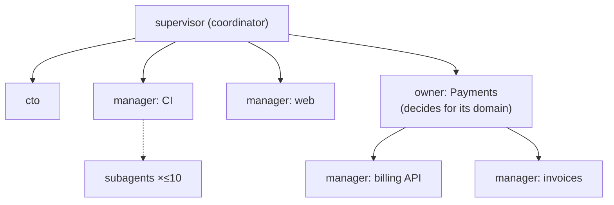

# Flatter agent trees, a coordinator/CTO split, parallel dispatch and spawn proposals

Tracking: RIG-6011 (parent RIG-6005). Rulings designed against (Matt, 2026-10-19 and
2026-10-20): coordination option B (separate coordinator and CTO agents), a flatter tree, about
ten subagents per Manager, and spawn proposals with evidence. This record builds on the role
taxonomy record (`compass-manager-role-taxonomy`, RIG-3066) and amends parts of it by citation.
Design only; no code ships with this record.

## Open Questions

Each question has options and a recommendation; Matt's decisions are tracked in RIG-6069. Q1 and Q2
are load-bearing: T2 and T3 build the CTO role from them. Q3 to Q5 change values the tasks set, so
they are load-bearing too.

### Q1. After direct event delivery lands, do the coordinator and CTO stay separate?

Compass will deliver CI, Linear comment and PR-merge events to the owning agent. Routing work then
moves out of the coordinator's turns (see [Event delivery](#event-delivery-shrinks-the-coordinator)).

- **(a) Keep them separate.** The coordinator shrinks to routing, spawn bookkeeping and incident
  intake, and some of that may later move into server code. The CTO stays off the event path, so its
  context holds direction, priorities, design intake and the final review pass.
- **(b) Merge them once events are direct.** One root agent does both. This saves one standing
  session, but operational traffic comes back into the context that holds long-term direction.
- **(c) Make the CTO the root and the coordinator its child.** The judgment voice sits at the top of
  the tree. Every escalation then passes through the CTO's context, which is the traffic option B
  is meant to keep away from it.

**Recommendation: (a).** The split is cheap: one extra standing session, and the CTO is mostly idle.
The cost of merging is the problem option B solves. Revisit only if the coordinator's remaining
work is fully in server code and has no agent left.

### Q2. Where does the CTO sit, and what is its role label?

- **(a) A fourth role, `cto`, as a child of the root `supervisor`.** It has its own prompt, receives
  no routed issues or alerts, and has the final review pass and design intake (RIG-6010).
- **(b) A peer root.** A second root with no parent. Today's code allows it (`CreateAgent` with an
  empty parent creates a root), but `docs/concepts/agent-roles.md` says "There is always exactly one
  at the root", and the tree view would show two trees.
- **(c) An `owner` named "CTO".** No new role, but an `owner` prompt tells it to decompose and
  delegate a domain, which is the opposite of the CTO's job.

**Recommendation: (a).** A role selects a block-0 prompt, so a role with a different posture needs a
new label (`agent-roles.md`: "The prompt *is* the role's capability and posture"). Placing it as a
child keeps the one-root rule. Its parent edge means the coordinator can reach it by DM; the CTO
does not report work up to it.

### Q3. How is a spawn proposal approved?

The prompts today say: "propose it on your home channel, wait for a yes, then spawn"
(`config/skills/management-trees/SKILL.md`). Nothing in the server checks this.

- **(a) Keep it a prompt rule, and add the evidence format.** The proposer posts a proposal with
  fixed fields on its home channel; the operator answers there.
- **(b) The proposer's parent approves.** The parent Manager or CTO approves within an operator-set
  budget, and only proposals over that budget go to the operator.
- **(c) A server approval gate.** A new `ProposeSpawn` RPC records a pending proposal, and
  `agents_spawn_peer` fails unless an approved proposal matches.

**Recommendation: (a) now, with (c) as a later task.** The rulings ask for surfacing with evidence,
then spawn after approval; (a) delivers that with prompt and skill edits alone. (c) is the right
end state for an unattended tree, but it needs an approval surface in the UI, which RIG-6010's review
gate will also need. Sharing that surface is cheaper than building it twice. (b) widens who can grow
the tree before any cap exists (spawn quotas are deferred to RIG-1574).

### Q4. What parallelism target goes in the prompts?

- **(a) Up to 10 concurrent subagents per Manager, cycling back to each as it reports.** This
  matches the ruling. The fleet settings set the task concurrency cap to 10.
- **(b) No number; tell the Manager to parallelise every independent slice.** The SDK default stays
  at 32.
- **(c) A number per role.** For example 10 for `manager`, 3 for `owner` and 1 for `supervisor`.

**Recommendation: (a), with the cap at 10 for every role.** The ruling names ten. The fleet setting
makes the runtime queue spawns past ten, so the prompt does not have to count, and it bounds
per-container load. An overlay can replace the setting (see [Parallel dispatch](#parallel-dispatch)).
The coordinator split already keeps upper tiers from doing implementation, so a per-role number adds
little.

### Q5. How flat is the default tree?

- **(a) Root `supervisor`, the `cto`, then lane `manager`s directly under the root. An `owner` only
  where a domain makes its own decisions.** Prompts and the skill teach this as the default shape.
- **(b) Keep today's default `supervisor → owner → manager` example, and add guidance against idle
  owners.**
- **(c) Remove the `owner` role.**

**Recommendation: (a).** It matches the ruling. Owners stay valid: the server already accepts any
role at any depth, and some domains do decide for themselves. Removing the role (c) would break the
existing role set (DL-new-A in the taxonomy record) for no gain.

## Problem / Intent

The running wave shows four problems, and Compass copies the wave's shape. First, coordinators
work through one task at a time, so a Manager with ten independent slices takes ten turns of
wall-clock time. Second, a lane that needs a new owner gets one only when someone notices. Third,
mid-tier owners sit idle between the root and the lanes. Fourth, one supervisor holds both routing
and long-term direction, and the routing traffic crowds out the direction.

This record designs the target tree shape, the coordinator/CTO split, parallel dispatch, and spawn
proposals. It also answers the RIG-6011 question of whether a worker's completion reaches its
Manager as an event or by polling.

## Approach

### Completion reaches the Manager as an event, not a poll

A worker is an in-process `task` subagent ("There is deliberately **no `worker` role**",
`docs/concepts/agent-roles.md`). Its completion stays inside the Manager's own session:

- **Async mode is on by default.** The SDK default for `async.enabled` is `true`
  (`config/settings-schema.ts` in `@oh-my-pi/pi-coding-agent` 18.0.11), and no fleet
  `config/settings/config.yml` exists on `main` to override it.
- **A finished job is pushed into the session.** `AgentSession.#deliverAsyncJobResult` enqueues the
  result on the yield queue as an `async-result` entry. The registration comment says: "completions
  for jobs this agent owns are injected into THIS session's run as async-result follow-ups".
  compass-agent creates the first session in the process, so it owns the `AsyncJobManager`.
- **An idle Manager wakes.** When the session is not streaming, `YieldQueue` schedules an idle flush
  (`#scheduleIdleFlush`), and `injectIdle` starts a turn. compass-agent tracks that turn through
  `agent_start`/`agent_end` like any other.

So the Manager loop the prompt describes works without polling
(`config/prompts/manager/SYSTEM.md`: "dispatch subagents -> end turn -> resume").

**One gap.** compass-agent starts its own turns with `this.#session.agent.prompt(...)`
(`packages/compass-agent/src/agent.ts`), not `session.prompt`. Those turns skip the SDK's
in-flight bookkeeping, so `yieldQueue.requestIdleFlush()` never runs when they end. A result that is
enqueued after the loop's last aside poll, but before `agent_end` clears streaming, waits until the
next message arrives. With ten workers, the last completion can strand this way. T1 fixes it:
compass-agent calls `session.yieldQueue.requestIdleFlush()` on every `agent_end`. The SDK marks
the stranding `agent_end` non-terminal (`willContinue: true` while an async result is queued), so
the call cannot wait for a terminal one. It is safe to call every time: it schedules only when
entries are queued, and the run returns while the session is streaming.

**Workers die with the Manager process.** A config-version change makes the runner reload the agent
(`agentHost.refreshOneContainer` → `reloadLocked` → `stream.Stop` in `go/internal/runner/host.go`).
A reload kills every in-process subagent and its pending result, and the manager prompt already says
"in-flight work is lost, so re-dispatch". At ten workers, one reload can lose ten slices. T1's
prompt rule tells the Manager to re-dispatch unfinished slices on resume, using its board's task
list. Shipping T1's own settings file is a bundle change that reloads every agent, so it lands
outside an active wave.

A **standing child Manager** is different. `agents_spawn_peer` returns once the server has
provisioned and started the child (`lifecycleService.SpawnAsAccount` in `go/server/lifecycle.go`).
Its later work reaches the parent only as an explicit DM report. When the child's session is lost,
`Consumer.OnSessionLost` queues it and `Consumer.drainLost` (`go/internal/delivery/settle.go`)
decides. A container or Runner-unknown loss wakes the child at once. An errored loss wakes it with a
capped backoff, but only when it owes work; otherwise drainLost logs "errored session owes nothing,
not waking" and the child stays down. The parent is not told in any case. T5 adds that notice.

### Parallel dispatch

The `manager` prompt already calls the Manager "a COORDINATOR, not a typist", and
`management-trees` already says "Keep parallel subagents on non-overlapping file zones". Neither
says how many workers to run, so the agent runs one at a time. The change:

- The three role prompts and `management-trees` gain one rule: dispatch every independent slice at
  once (Q4). The runtime holds the rest: each async `task` job waits on the session's spawn
  semaphore (`TaskTool.#spawnSemaphore`, sized by `task.maxConcurrency`), so the Manager never holds
  slices back across turns.
- Every parallel worker gets its own jj workspace. The Compass `jj` skill already teaches this
  ("Workspaces — one per parallel subagent", `config/skills/jj/SKILL.md`).
- A new fleet settings document `config/settings/config.yml` sets the cap as nested YAML
  (`task:` / `maxConcurrency: 10`); `Settings.get` resolves by path and ignores a flat dotted key.
  The bundle door admits that member (`settingsMember` in `go/cmd/compass/bundle.go`), and the agent
  loads it as a read-only overlay (`readMountedSettingsPath` in
  `packages/compass-agent/src/config-reader.ts`).
- The cap is a default, not a lock. Config layers replace `settings/config.yml` as a whole file
  (`applyConfigLayer` in `go/internal/store/agent_config_merge.go`), so a tenant, user or role
  overlay that ships its own settings file drops back to the SDK default of 32 unless it repeats the
  key. Locking it is out of scope.
- The `supervisor` and `cto` dispatch mostly to the tree, not to subagents, so the cap rarely binds
  for them.

### The tree shape

- **`supervisor`** stays the one root. It routes, handles incidents and spawn bookkeeping, and is the
  operator's first contact.
- **`cto`** (new, Q2) is the root's child. It has no lane and receives no routed work. It holds
  direction and priorities, takes design intake, and does the final review pass (RIG-6010).
- **`manager`**s hang directly under the root by default.
- **`owner`**s are used only where a domain makes its own decisions, such as its own design
  records, priorities or operator. An owner that only forwards work adds a hop with no judgment, and
  the guidance says not to create one.

The server needs no change for this shape. Any role may parent any role
(`lifecycleService.SpawnAsAccount` checks only `store.IsManagerRole`), and owners already nest
freely.

### Event delivery shrinks the coordinator

Matt expects direct event delivery to remove most routing turns: CI, Linear comment and PR-merge
events go to the agent that owns the PR or issue. When it lands, the coordinator's remaining work is
intake of unowned issues, incidents, spawn bookkeeping and operator first contact. This record does
not design event delivery; it fixes the role boundary so that delivery can land without moving the
CTO. Q1 decides what happens to the coordinator afterwards.

### Spawn proposals

Every tier proposes a spawn when a lane needs a new owner or manager. The proposal states the
evidence. Under Q3 (a), it is a home-channel post with these fields, and the skill gives a template:

| Field | Content |
| --- | --- |
| Proposed node | role, name by function, persona summary, parent |
| Evidence | open issues in the area and their age, queue depth, the longest wait, and how many unrelated issues the proposer currently holds |
| Cost | one standing session and container |
| Alternative | rebalance inside the subtree, or leave the work where it is |

The trigger to propose is any of: issues in an area wait longer than a day, the proposer holds work
across two or more unrelated areas, or a domain has started making its own decisions. These
thresholds are prompt guidance; Q3 (c) would move them into a server check.

### Alternatives considered

- **A single root that does both routing and direction (option A).** Matt ruled option B.
- **Raising parallelism with more standing Managers instead of subagents.** Each standing node
  costs a handle and a container. DL-134 rejects per-implementer containers.
- **A transport change for worker completion.** It is not needed: completion is already pushed, and
  the one stranding gap is a one-line flush call in compass-agent (T1).

## Global Constraints

- The role set grows from three to four (`supervisor`, `owner`, `manager`, `cto`) only if Matt picks
  Q2 (a). Every hard-coded role list changes together (T2).
- Role prompts live at `config/prompts/<role>/SYSTEM.md`; a new role needs a prompt before the server
  accepts it, or the agent boots on the default prompt.
- Workers stay in-process `task` subagents (DL-134). This record adds no worker tree nodes.
- No new usage-billed resource. One extra standing session for the `cto`; no new metrics.
- Prompt text follows the existing prompts' style: imperative and short.

## Plan

### T1 — Parallel dispatch in prompts and settings `[config]`

- Add the dispatch rule (Q4) to `config/prompts/{supervisor,owner,manager}/SYSTEM.md` and the
  "Scope the subagent" section of `config/skills/management-trees/SKILL.md`: dispatch every
  independent slice at once, and on resume re-dispatch any slice the board shows unfinished.
- After Q4 is ruled, add `config/settings/config.yml` with nested `task:` / `maxConcurrency:` set to
  the ruled cap (10 if Q4 takes the recommendation). Ship it outside an active wave, because the
  bundle change reloads every agent. The prompt rule and the idle-flush call ship now.
- In compass-agent's `#trackTurn` (`packages/compass-agent/src/agent.ts`), call
  `session.yieldQueue.requestIdleFlush()` on every `agent_end`, terminal or not.
- **Interfaces:** consumes the bundle `settingsMember` and the SDK's public
  `YieldQueue.requestIdleFlush()`; produces no API.
- **Test:** a passthrough test asserts `settings.get("task.maxConcurrency") === 10`, as
  `cli.config-passthrough.test.ts` does for `compaction.keepRecentTokens`. An agent test enqueues an
  async result just before `agent_end` and asserts a follow-up turn starts; it fails without the
  flush call.

### T2 — The `cto` role `[compass-server + config]`

- Add `cto` everywhere the three roles are listed:
  - `managerRoles` in `go/internal/store/types.go`;
  - the `role` union and its description in `spawnParameters`
    (`packages/compass-agent/src/lifecycle.ts`), which rejects other roles before the server sees
    them;
  - the `ta.role IN ('supervisor', 'owner', 'manager')` filters in
    `go/internal/store/queries/agent_config.sql`, then regenerate `go/internal/store/db`;
  - the CLI help and both errors in `validateAgentSpawnRole` (`go/cmd/compass/agent_spawn.go`);
  - the role comments on `CreateAgentRequest` (`comms.proto`) and
    `ProvisionAgentWorkspaceRequest` (`compass.proto`), then regenerate;
  - "The three-role taxonomy" in the three role prompts and "a closed set of three" in
    `management-trees`.
- Add `config/prompts/cto/SYSTEM.md`: no lane, no routed work, owns direction, priorities, design
  intake and the final review pass; reports to the operator on its home channel.
- The root `supervisor` spawns the `cto` with `agents_spawn_peer` after operator approval, like any
  other node. Seeding stays root-only (`seedRootSupervisor`).
- **Interfaces:** `store.IsManagerRole("cto") == true`; `agents_spawn_peer` and `CreateAgent` accept
  it; a role-scoped config overlay for `cto` applies.
- **Test:** the role-validation tests gain a `cto` case and an unknown role still fails; a lifecycle
  tool test accepts `cto`; an agent-config pgtest shows a `cto` role overlay is selected.

### T3 — Tree-shape guidance and the concepts doc `[docs + config]`

- Rewrite the default example in `management-trees` to the Q5 shape, and add "don't create an
  owner that only forwards".
- Update `docs/concepts/agent-roles.md` with the four roles and the coordinator/CTO split.
- **Interfaces:** none.

### T4 — Spawn-proposal template `[config]`

- Add the proposal fields and triggers to `management-trees` and the three prompts' approval lines.
- **Interfaces:** none (Q3 (a)).

### T5 — Child lifecycle notice to the parent `[compass-server]`

- Hook the server's existing `SessionLostSink` path (`Consumer.OnSessionLost` →
  `Consumer.drainLost` in `go/internal/delivery/settle.go`), not `Hub.deliverSession`. Container
  loss and Runner-unknown sessions reach only that path, and `AGENT_SESSION_STATE_STOPPED` is always
  a deliberate stop.
- On a loss for an agent with a parent, post one system-sender (DL-191) message on the **parent's
  home channel**, through `comms.PostAsAccount` after `EnsureChannelMember`, as `postSetupThread`
  does (`go/server/serve_seed.go`). It is not the parent/child DM: the child is a mandatory member of
  that DM, and a system post there would wake the lost child at once and skip the errored-wake
  backoff.
- The notice states which branch drainLost took: "re-waking" when it wakes or defers a wake, and
  "down, not re-woken" when an errored child owes no work. The second case is the one the parent
  must act on.
- Rate-limit to one notice per (child, notice type) per `erroredWakeResetAfter` window. A crash loop
  does not wake the parent on every cycle, and a recent "re-waking" notice never hides a "down"
  notice. Keying "down" too bounds a loop where the parent DMs the child and it crashes again with
  nothing owed; that path records no errored-wake strike.
- **Interfaces:** consumes `OnSessionLost(sessionID, account, errored)`. The `Consumer`
  (`go/internal/delivery/consumer.go`) holds no poster and no parent lookup today, so T5 adds:
  - a `DeliveryReads` method returning an account's `parent_agent_id` and the parent's
    `HomeChannelID`;
  - a narrow `LostChildNotifier` interface (post as `@compass` to one channel), set on the Consumer
    at server assembly in `go/server/sinks.go` with the existing setter pattern, which avoids the
    delivery↔server construction cycle.

  It produces at most one message per child per notice type per window on the parent's home
  channel.
- **Test:** a delivery pgtest covers five cases: a parented child lost twice inside one window
  gives one notice on the parent's home channel, none on the DM, and no extra child wake; an errored
  child with no owed work gives the "down" notice; a "re-waking" notice followed in the same window
  by an errored loss with nothing owed still gives the "down" notice; a container loss gives the
  "re-waking" notice; a root agent's loss gives none.

## Tasks

- [ ] T1 — Parallel dispatch rule and the idle-flush call now; the concurrency cap after Q4
- [ ] T2 — `cto` role and prompt (after Q1, Q2)
- [ ] T3 — Tree-shape guidance and concepts doc (after Q5)
- [ ] T4 — Spawn-proposal template (after Q3)
- [ ] T5 — Rate-limited lost-child notice on the parent's home channel

## Ledger delta

DL-644 and DL-645 record only what Matt ruled on 2026-10-19. The `cto` label, the cap of 10 as a
setting, the tree shape and the approval path wait on Q1 to Q5 (RIG-6069) and get their own
decision files when ruled. DL-643 and DL-646 carry `design` as the ratifier until Matt approves this
record.

- **DL-643:** a worker's completion reaches its Manager as a pushed async-result follow-up;
  compass-agent requests an idle flush after each turn it drives so no result strands.
- **DL-644:** Managers dispatch independent slices in parallel, about 10 at a time, each worker in
  its own jj workspace.
- **DL-645:** coordination splits into a root coordinator and a separate CTO agent with no routed
  work (option B).
- **DL-646:** a standing child's session loss posts one rate-limited system-sender notice on its
  parent's home channel.
